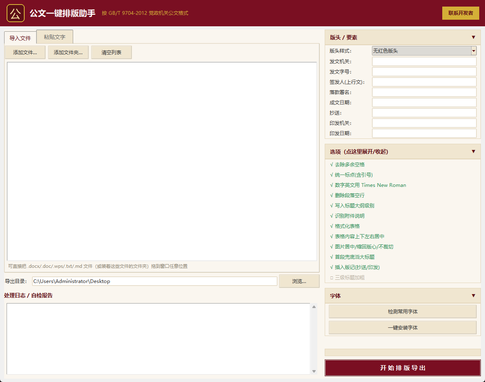

# 公文一键排版助手

按 **GB/T 9704—2012《党政机关公文格式》** 做一键排版的 Windows 桌面工具。
把 `.docx / .doc / .wps / .txt / .md` 丢进来，自动套用版头、标题层级、字体字号、
行距缩进、落款、版记、表格与图片的公文规范，输出一份可直接用的公文。

> **纯本地运行：不联网、不上传任何内容、不修改原始文件**（所有处理都在临时副本上做，结果另存为新文件）。



---

## 主要能力

| 模块 | 说明 |
|---|---|
| 版头 | 三档：无红色版头 / 正式发文（大红头）/ 简化文头（小红头） |
| 标题层级 | 自动识别 `一、` `（一）` `1.` `（1）` 四级，套用黑体 / 楷体 / 仿宋 + 大纲级别 |
| 文本规范化 | 去空格（半角/全角/不间断/零宽/制表符）、标点全半角统一、引号智能配对、省略号与破折号归一、日期去虚位 |
| 版式 | A4、天头 37mm / 订口 28mm、正文三号仿宋、固定行距、首行缩进 2 字符、两端对齐 |
| 主送 / 落款 | 主送机关顶格；成文日期右空 4 字，署名与日期右端对齐 |
| 附件说明 | 左对齐 + 悬挂缩进，`1. 2. 3.` 序号自动逐项对齐 |
| 表格 | 整表居中、**单元格上下左右居中**、表头黑体加粗、表体仿宋 |
| 图片 | 居中、去缩进、**行距放开（避免固定行距把大图裁掉）**、超版心等比缩回、图题居中 |
| 版记 | 抄送 / 印发机关 / 印发日期，单双页页码（一字线 `— 1 —`） |
| 字体 | 一键检测 / 安装 4 种公文字体（用户级安装，免管理员权限） |
| 批量 | 多文件批量处理、拖拽导入、文件夹导入 |

---

## 快速开始

### 1. 直接跑源码

```powershell
py -3.8 -m pip install -r requirements.txt
py -3.8 gwps_main.py
```

### 2. 打包成 exe

```powershell
py -3.8 -m PyInstaller --noconfirm build.spec
# 产物：dist\公文一键排版助手.exe
```

> 目标系统若为 Windows 7 SP1，需要机器上已有 **UCRT**（装 KB2999226 或 VC++ 2015-2022 运行库）。
> 环境要求：**Python 3.8.x 64 位**（最后一个支持 Win7 的 Python 版本）。

### 3. 依赖

见 `requirements.txt`（python-docx / lxml / Pillow / pywin32 / tkinterdnd2）。

---

## 目录结构

```
gwps_main.py        程序入口
gwps_gui.py         图形界面（深红政务主题、拖拽导入、可折叠参数面板）
gwps_engine.py      排版引擎（版头/标题/正文/落款/版记/表格/图片/网格/页码）
gwps_normalize.py   文本规范化（空格/标点/引号/省略号/破折号/日期）
gwps_structure.py   标题层级识别、自动编号展开、主副标题识别
gwps_config.py      国标参数与默认配置
gwps_fonts.py       公文字体检测与一键安装
gwps_settings.py    设置持久化（写注册表，exe 旁边不留文件）
gbt_check.py        GB/T 四类核查器（把每个修过的问题固化成一条规则）
loop_auto.py        五步验证法循环：随机造脏文档 → 排版 → 核查 → 收敛
test_*.py           常规回归测试
build.spec          PyInstaller 打包配置
assets/             图标、联系开发者二维码
fonts/              公文字体存放目录（字体文件不入库，见下）
```

---

## 自测与回归

本项目用「**五步验证法**」保证改动不会悄悄回退：

```powershell
py -3.8 loop_auto.py     # 连续 5 轮全新随机文档 0 违规 → 打印 CONVERGED
py -3.8 test_engine.py   # 逐项回归测试
```

`loop_auto.py` 每轮随机生成 ≥5000 字公文（要素齐全：标题/主送/一~四级序数/正文/附件说明/
署名/成文日期/附注/附件另页/表格/图片/版记），并**故意埋雷**：半角标点、直引号、`...`、`--`、
全角与半角空格、不间断空格、零宽符、制表符、软回车、日期虚位、放大字间距、无空格的附件序号，
以及**未居中的表格**和**超版心的图片**。`gbt_check.py` 逐项核查，任何一项不合格即判失败。

> 修复任何问题时，请**同时把该问题固化成 `gbt_check.py` 里的一条新规则**，否则下次重构会回退。

---

## 字体说明（重要）

本程序使用的中文字体属于**第三方商业/系统字体，不可随源码再分发**，因此 `fonts/` 里的
字体文件**不入库**。运行时请自行准备：

- `仿宋_GB2312`、`楷体_GB2312`、`黑体`：多数中文 Windows 已自带或可从系统安装包获取；
- `方正小标宋简体`：商业字体，请自行购买或由所在单位提供授权版本。

把字体文件放到 `fonts/` 目录后重新打包，即可让程序内置并支持「一键安装字体」。

---

## 免责声明

见 [LICENSE.txt](LICENSE.txt)。

> 本软件仅用于对**非涉密、可公开**的公文材料进行格式排版。
> 严禁用于处理涉及国家秘密、工作秘密、商业秘密或个人隐私的涉密文件。
